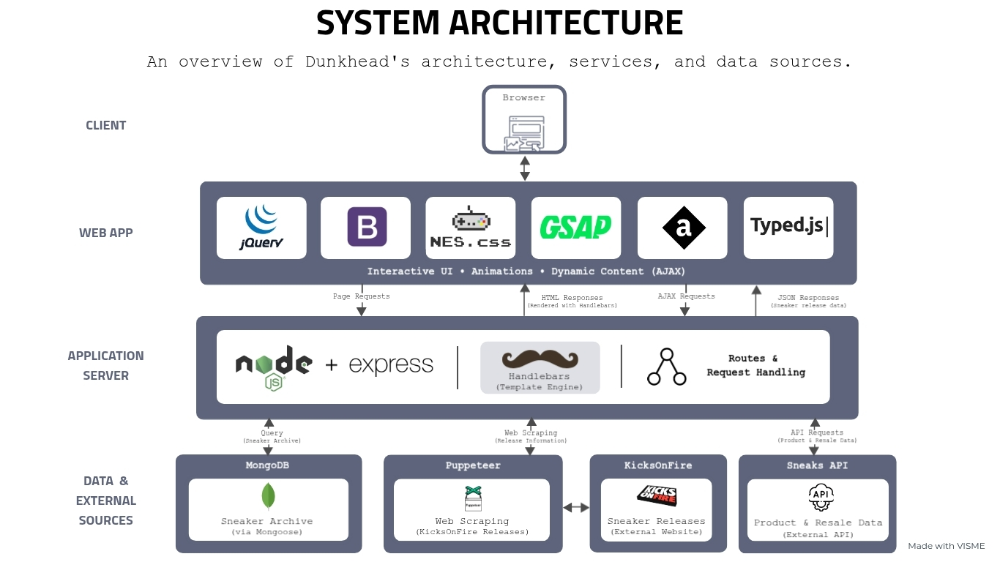

<!-- PROJECT LOGO -->
<div align="center">
  

  <h3 align="center" style="font-size: 2.1em; font-weight: bolder;">dunkhead</h3>

  <p align="center">
    Exploring the history, culture, and releases of Nike Dunk SBs.
    <br />
    <br />
    <a href="https://github.com/ninoestrada/dunkhead/issues/new?labels=bug&template=bug_report.md">Report Bug</a>
    ·
    <a href="https://github.com/ninoestrada/dunkhead/issues/new?labels=enhancement&template=feature_request.md">Request Feature</a>
  </p>
</div>

<!-- ABOUT THE PROJECT -->

## 📖 About the Project


**dunkhead** is a web application dedicated to the history, culture, and releases of Nike Dunk SBs. It brings together a curated sneaker archive, release news, and information about sneaker culture in an interactive, retro-inspired experience.

Inspired by the "sneaker game," a term used to describe the culture of collecting, trading, and buying sneakers, dunkhead puts a playful, 8-bit spin on sneaker culture. Rather than focusing on buying and selling sneakers, the project explores their history and cultural significance through a retro video-game aesthetic. The experience features original pixel-art illustrations of sneakers and shoeboxes, hand-drawn in Adobe Illustrator, along with a custom homepage video edited in Adobe Premiere Pro.


### ✨ Features

- **Sneaker Collection:** Browse a curated collection of Nike Dunk SBs, featuring original pixel-art illustrations, nicknames, and box designs.
- **Release Information:** Explore upcoming, popular, and past sneaker releases using information retrieved from external sources.
- **Interactive Experience:** Explore animated sneaker collections and interactive shoe previews through a retro-inspired interface.


<h2>
  
  What Are Nike Dunk SBs?
</h2>

**Nike Dunk SBs** are skateboarding sneakers introduced in 2002 by Nike SB (Nike Skateboarding). Originally adapted from the Nike Dunk basketball shoe, they became known for their distinctive colorways, limited releases, and collaborations with artists, brands, and skate shops.

What sets Nike Dunk SBs apart is their connection to local skateboarding communities. From the beginning, Nike SB partnered with independent skate shops that helped support and shape skate culture, a tradition that continues through exclusive releases and its Orange Label program. This connection helped Nike Dunk SBs develop a dedicated following within sneaker culture, bridging skateboarding, streetwear, art, and design.

### 🛠️ Tech Stack

|                     Frontend                     |                    Backend                    |
| :----------------------------------------------: | :-------------------------------------------: |
| [![JavaScript][JavaScript.com]][JavaScript-url]  |    [![Node.js][Node.js.com]][Node.js-url]     |
|       [![jQuery][JQuery.com]][JQuery-url]        |    [![Express][Express.com]][Express-url]     |
|   [![Bootstrap][Bootstrap.com]][Bootstrap-url]   |    [![MongoDB][Mongodb.com]][Mongodb-url]     |
|       [![NES.css][Nescss.com]][Nescss-url]       |   [![Mongoose][Mongoose.com]][Mongoose-url]   |
|          [![GSAP][GSAP.com]][GSAP-url]           | [![Puppeteer][Puppeteer.com]][Puppeteer-url]  |
| [![Animate.css][Animatecss.com]][Animatecss-url] | [![Sneaks API][SneaksAPI.com]][SneaksAPI-url] |
|     [![Typed.js][TypedJS.com]][TypedJS-url]      |  [![Moment.js][MomentJS.com]][MomentJS-url]   |

**Template Engine:** [Handlebars](https://handlebarsjs.com/)

**Design & Media:** [Adobe Illustrator](https://www.adobe.com/products/illustrator.html) · [Adobe Premiere Pro](https://www.adobe.com/products/premiere.html)

## 🏗️ Architecture

### System Architecture

The diagram below illustrates dunkhead's architecture, including its browser-based interface, Node.js and Express server, Handlebars template rendering, MongoDB sneaker archive, and external sneaker data integrations.



<!-- GETTING STARTED -->

## 📦 Getting Started

### **💾 Installation**

1. Clone the repository.
   ```sh
   git clone https://github.com/ninoestrada/dunkhead.git
   cd dunkhead
   ```
2. Install the dependencies.
   ```sh
   npm install
   ```
3. Configure the MongoDB connection in modules/credentials.js using the mongo.connectionString setting. Keep database credentials private and out of version control.
4. Populate the database with the initial sneaker collection:
   ```sh
   node database.js
   ```

### **▶️ Running the Program**

```sh
node server.js
```

The application runs on port 3000 by default, or the port specified by the PORT environment variable.

The news page requires an internet connection to retrieve sneaker release information from KicksonFire.

<!-- LICENSE -->

## 📜 License

Distributed under the MIT License. See [`LICENSE.txt`](LICENSE.txt) for more information.

<!------- MARKDOWN LINKS & IMAGES ------->

[Button Click]: https://img.shields.io/badge/Click_Me!-37a779?style=for-the-badge
[JavaScript.com]: https://img.shields.io/badge/JavaScript-F7DF1E?style=for-the-badge&logo=javascript&logoColor=black
[JavaScript-url]: https://developer.mozilla.org/en-US/docs/Web/JavaScript
[JQuery.com]: https://img.shields.io/badge/jQuery-0769AD?style=for-the-badge&logo=jquery&logoColor=white
[JQuery-url]: https://jquery.com
[Handlebars.com]: https://img.shields.io/badge/Handlebars-FC8019?style=for-the-badge&logo=handlebars
[Handlebars-url]: https://handlebarsjs.com/
[Node.js.com]: https://img.shields.io/badge/Node.js-43853D?style=for-the-badge&logo=node.js&logoColor=white
[Node.js-url]: https://nodejs.org/en
[Bootstrap.com]: https://img.shields.io/badge/Bootstrap-563D7C?style=for-the-badge&logo=bootstrap&logoColor=white
[Bootstrap-url]: https://getbootstrap.com/
[Express.com]: https://img.shields.io/badge/Express.js-404D59?style=for-the-badge
[Express-url]: https://expressjs.com/
[Nescss.com]: https://img.shields.io/badge/NES.css-100000?style=for-the-badge&logo=nes
[Nescss-url]: https://nostalgic-css.github.io/NES.css/
[Mongodb.com]: https://img.shields.io/badge/MongoDB-4EA94B?style=for-the-badge&logo=mongodb&logoColor=white
[Mongodb-url]: https://www.mongodb.com/
[Mongoose.com]: https://img.shields.io/badge/Mongoose-880000?style=for-the-badge&logo=mongoose&logoColor=white
[Mongoose-url]: https://mongoosejs.com/
[Animatecss.com]: https://img.shields.io/badge/Animate.css-430098?style=for-the-badge&logo=Animatecss
[Animatecss-url]: https://animate.style/
[SneaksAPI.com]: https://img.shields.io/badge/Sneaks%20API-30363D?style=for-the-badge&logo=SneaksAPI
[SneaksAPI-url]: https://github.com/druv5319/Sneaks-API
[Puppeteer.com]: https://img.shields.io/badge/Puppeteer-21C25E?style=for-the-badge&logo=Puppeteer
[Puppeteer-url]: https://pptr.dev/
[GSAP.com]: https://img.shields.io/badge/GSAP-000000?style=for-the-badge&logo=GSAP
[GSAP-url]: https://gsap.com/
[MomentJS.com]: https://img.shields.io/badge/Moment.js-00C7B7?style=for-the-badge&logo=MomentJS
[MomentJS-url]: https://momentjs.com/
[TypedJS.com]: https://img.shields.io/badge/Typed.js-30363D?style=for-the-badge
[TypedJS-url]: https://github.com/mattboldt/typed.js
